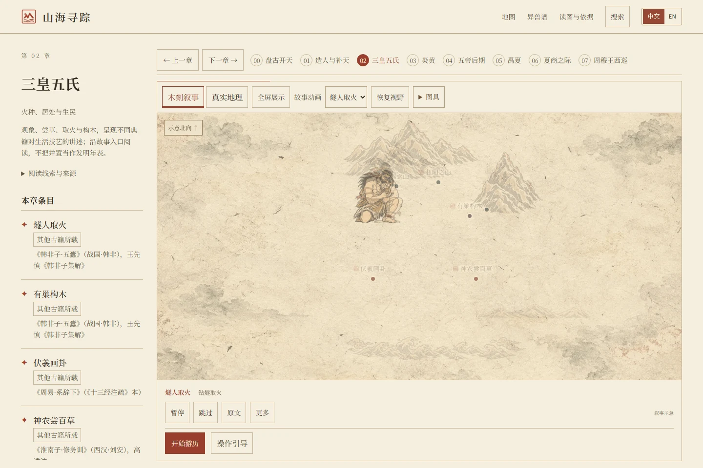
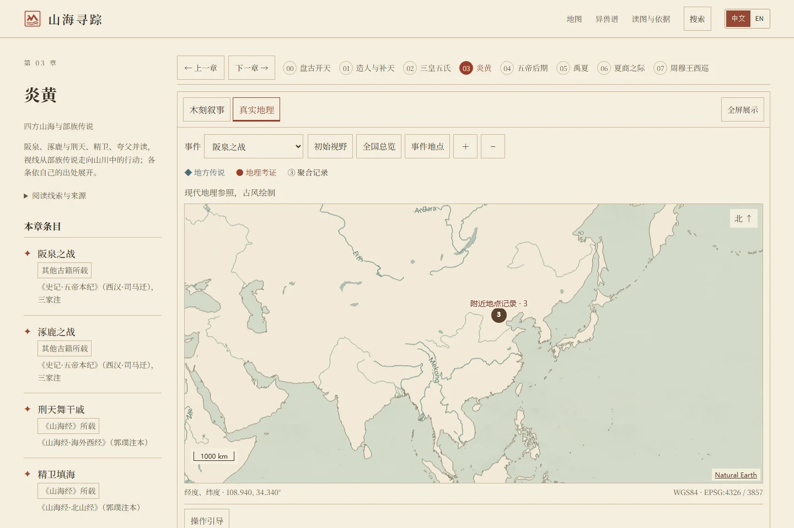
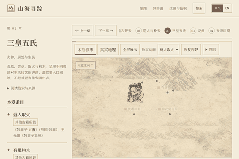

# MythMap — Where the Mountains and Seas Begin

A bilingual atlas for exploring Chinese myths, discovering creatures and reading their sources.

[](https://hyc1005.github.io/mythmap/)
[](https://github.com/hyc1005/mythmap/actions/workflows/deploy-pages.yml)

**English** · [简体中文](README.zh-CN.md)

## At a glance

- **What it is**: Woodcut illustrations and interactive maps connecting myths from the *Classic of Mountains and Seas* and other ancient texts.
- **What you can do**: Watch stories, read source passages, filter creatures and deities, and inspect separate geographic evidence.
- **What it cannot prove**: Illustrations, narrative coordinates and modern place associations cannot establish where mythical events occurred.


## The ink opening


*46-second screen recording of the opening from a local build of `625f118` (2026-11-08); the [full-quality MP4](https://github.com/hyc1005/mythmap/releases/download/media-2026-11-08/ink-opening-2026-11-08.mp4) is the untouched recording.*

## What you can do

| Story playback | Bestiary |
| --- | --- |
|  |  |
| Follow a story, pause or replay, and open its textual sources. | Filter by name, book or body form; namesakes retain separate accounts. |
| **Geographic evidence** | **12-second walkthrough** |
|  |  |
| Inspect modern place references separately from narrative diagrams. | Recorded from the actual interface, showing playback, chapter source notes and morphology evidence. |

## Scope

- **480 reading passages**: Southern 43, Western 82, Northern 92, Eastern 51 and Central 212 — the five Mountain Classics. 海经 and 大荒经 are not part of the reading corpus; a few bestiary entries quote them as cross-references. See the [content inventory](docs/content-coverage.md).
- **312 creature accounts and 72 deity accounts**: namesake groups, six body-form categories and combined book, feature and reading filters, with 12 cards initially and up to 24 more per click; same-name accounts are selected in the detail view.
- **Reading guidance and morphology evidence**: chapter introductions, source notes and connections; main text, commentary and comparison accounts remain distinct, with missing or uncertain forms stated explicitly.
- **Chinese and English**: story playback, source reading, search, favorites and reading-position recovery. The prologue and seven chapters are the project's narrative arrangement.

## Sources and licensing

The maintainer developed the code with generative models and releases it under [MIT](LICENSE). No additional reuse permission is granted for project paraphrases, model-generated translations or AI artwork. Source transcriptions, scans, fonts and geographic data retain their own conditions; see [asset provenance and licensing](ASSETS.md).

The base text of the *Classic of Mountains and Seas* is the Sibu Congkan facsimile of the Ming Chenghua edition (Guo Pu's commentary). Transcriptions come from a fixed [Wikisource](<https://zh.wikisource.org/wiki/山海經_(四部叢刊本)>) revision; page scans come from [Wikimedia Commons](<https://commons.wikimedia.org/wiki/File:Sibu_Congkan0465-郭璞-山海經-2-1.djvu>) and are transcluded through Wikisource. Wikisource states that its text is offered under [CC BY-SA 4.0](https://creativecommons.org/licenses/by-sa/4.0/); the scan files are labelled public domain (PD-old) on Commons. These are source statements, not independent legal conclusions; the project's paraphrases, model translations and editorial text fall outside those licences.

Translations are model-generated. Illustrations use OpenAI image generation, sometimes with existing project artwork as an internal style reference. Unverified models and third-party rights remain explicitly unresolved; neither professional translation review nor freedom from infringement is guaranteed.

Use [CITATION.cff](CITATION.cff) to cite the project and credit the relevant sources when citing individual texts, scans or map data. The geographic screenshot credits Natural Earth; embedded UI assets retain their source-specific conditions.

## Development and maintenance

<details>
<summary>Repository map and data maintenance</summary>

| Path | Responsibility |
| --- | --- |
| [frontend/](frontend/) | React/Vite website; Pages publishes its build output |
| [frontend/src/](frontend/src/) | UI, state, localization and bestiary metadata |
| [frontend/public/data/](frontend/public/data/) | Runtime data and published artwork variants |
| [frontend/artwork-source/](frontend/artwork-source/) | Originals, prompts and reproducibility records |
| [data/](data/README.md) | Book builders, source snapshots and review records |
| [frontend/scripts/](frontend/scripts/README.md) | Verification, preview, image and font tools |
| [docs/](docs/README.md) | Data contracts, source inventories and documentation |
| [backend-java/](backend-java/run.ps1) | Optional read-only world-data service for development |

Short names, body forms and namesake groups are kept in `frontend/src/bestiary-metadata.json`, apart from the generated text. The [API contract](docs/API_CONTRACT.md) covers the endpoints. Originals and scans stay where they are; [docs/large-files.tsv](docs/large-files.tsv) just records how large they are.

### Optional development service

Run [run.ps1](backend-java/run.ps1) (JDK 17+) when you want `/api/world` during development; the site also reads bundled data directly. The early FastAPI/PostGIS prototype is gone from `main`, though its code and notes remain in the Git history.

</details>

<details>
<summary>Local development</summary>

Node.js 22 or newer. Most original artwork and scans can stay out of your checkout — see the [lightweight checkout](data/README.md#轻量检出与原图分发) (Python 3.10+).

```bash
cd frontend
npm ci
npm run dev -- --host 127.0.0.1
```

Open [127.0.0.1:5173](http://127.0.0.1:5173/). The dev server looks for the Java API on port 8081 and otherwise reads bundled data. Production does the same unless `VITE_API_BASE_URL` is set — that value ends up public in the build.

The geographic view draws its land, lakes and rivers from a bundled Natural Earth v5.1.2 50m extract, styled to match the paper atlas and labelled as modern reference. It needs no map key. Versions, source hashes and processing steps are in `frontend/public/data/geography/natural-earth-50m-v5.1.2.sources.json`; `python data/build_geography_basemap.py --check` compares them. If the basemap fails to load, the local evidence stays available.

</details>

<details>
<summary>Build and complete verification</summary>

From `frontend/`:

```bash
npx playwright install chromium webkit
npm run build -- --base /mythmap/
npm run verify:data
npm run verify:cache
npm run verify:publish
node scripts/with-preview.mjs --base /mythmap/ -- node scripts/verify-bestiary.mjs
node scripts/with-preview.mjs --base /mythmap/ -- node scripts/verify-design.mjs
```

More checks — reading, search, narrative, each book — are listed in the [script index](frontend/scripts/README.md). `with-preview.mjs` picks a free port and shuts the preview down when the run ends. For a manual preview, run `npm run preview:managed -- --base /mythmap/` and stop it with Ctrl+C; don't rebuild `dist/` while a test is reading it. Screenshots land in `output/qa/`. Chromium and WebKit are supported; Firefox isn't part of the matrix.

</details>

<details>
<summary>Deployment and rollback</summary>

Under Settings → Pages, choose **GitHub Actions**. No map-service secret is needed for the bundled basemap. Pushes to `main` that touch `frontend/`, `data/`, `backend-java/` or the workflows run [.github/workflows/deploy-pages.yml](.github/workflows/deploy-pages.yml); docs-only pushes don't deploy, and you can also start it by hand.

The deploy job waits for the checks and publishes exactly the artifact they verified. Keep `dist/`, dependencies, environment files and QA output out of Git. To roll back, revert the commit and push.

</details>

<details>
<summary>Historical coursework</summary>

[Course report](docs/coursework/课程报告.md) · [Presentation walkthrough](docs/coursework/答辩演示流程.md)

Two course documents, kept for reference and outside the current build and navigation.

</details>
