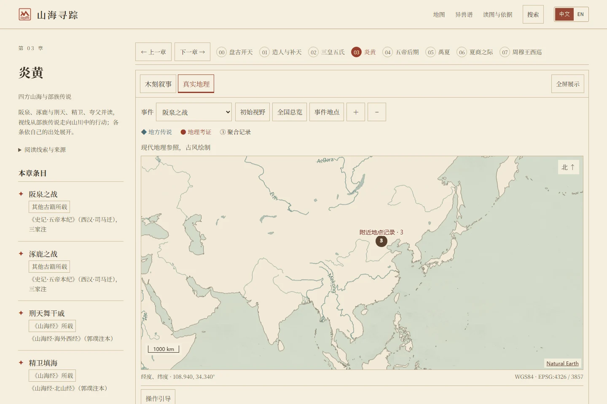

# 山海寻踪 MythMap

一部可以游历、检索与对照原文的双语中国神话图谱。

[](https://hyc1005.github.io/mythmap/)
[](https://github.com/hyc1005/mythmap/actions/workflows/deploy-pages.yml)

[English](README.md) · **简体中文**

## 快速了解

- **这是什么**：以木刻插画与互动地图串联《山海经》及其他古籍中的神话。
- **能做什么**：看故事、读原文、筛选异兽神祇，并查看独立的地理证据。
- **不能证明什么**：插画、叙事图坐标和现代地点关联，均不能证明神话事件发生的位置。


## 水墨开篇


*46 秒开屏录屏，2026-11-08 自 `625f118` 的本地构建窗口录制；[原始画质 MP4](https://github.com/hyc1005/mythmap/releases/download/media-2026-11-08/ink-opening-2026-11-08.mp4) 为未重编码的录制文件。*

## 能做什么

| 故事播放 | 异兽谱 |
| --- | --- |
|  |  |
| 随故事展开画面，也可暂停、重播与查阅原文。 | 按名称、篇目和形貌筛选，同名异篇保留独立记载。 |
| **地理证据** | **12 秒操作演示** |
|  |  |
| 将现代地点资料与神话叙事分开查看。 | 实际界面录制，展示故事播放、章节来源提示与形貌依据。 |

## 内容范围

- **480个阅读段**：南山43、西山82、北山92、东山51、中山212，即五部山经；海经与大荒经不在阅读范围内，异兽谱只有少量条目引及。范围与审核状态见[内容盘点](docs/content-coverage.md)。
- **312条异兽、72条神灵**：支持同名分组、六类形貌及篇目／特征／已读收藏组合筛选，首批显示12张主卡片，每次追加最多24张；同名记载在详情中选择。
- **阅读线索与形貌依据**：八章导语、来源提示与章间衔接；正文、郭注和比较记述分层，未记形貌或有异说者保留说明。
- **中文与英文**：故事播放、原文阅读、搜索、收藏和续读；序章与七章为项目叙事编排。

## 来源与许可

代码由维护者驱动模型开发，按[MIT](LICENSE)开放。项目白话与模型译文、AI插画暂不额外开放复用；古籍录文、扫描、字体与地图按各自来源条件处理，详见[资产来源与许可](ASSETS.md)。

《山海经》底本为《四部丛刊》景江安傅氏双鉴楼藏明成化庚寅刊本（晋郭璞传）。电子录文取自[维基文库](<https://zh.wikisource.org/wiki/山海經_(四部叢刊本)>)的固定修订快照，影印页取自[维基共享资源](<https://commons.wikimedia.org/wiki/File:Sibu_Congkan0465-郭璞-山海經-2-1.djvu>)并经维基文库页面转引。维基文库声明其文字按 [CC BY-SA 4.0](https://creativecommons.org/licenses/by-sa/4.0/deed.zh) 提供；影印页在共享资源标注为公有领域（PD-old）。以上均为来源方声明，不是独立法律结论；本项目的白话、模型译文与整理文字不在上述许可范围内。

翻译由模型生成；插画使用OpenAI图像生成工具，部分以项目既有插画统一风格。具体模型和第三方权利未能核实的项目保留“未记录／需确认”，不作专业审校或无侵权保证。

引用项目可使用[CITATION.cff](CITATION.cff)；引用具体原文、扫描或地图数据时，请同时标明对应来源。地理截图保留Natural Earth署名，界面内嵌素材仍按各自来源条件适用。

## 开发与维护

<details>
<summary>目录与数据维护</summary>

| 路径 | 职责 |
| --- | --- |
| [frontend/](frontend/) | React/Vite网站，Pages部署其构建产物 |
| [frontend/src/](frontend/src/) | 界面、状态、双语与异兽展示元数据 |
| [frontend/public/data/](frontend/public/data/) | 运行数据与发布插画版本 |
| [frontend/artwork-source/](frontend/artwork-source/) | 原图、提示词与复现记录 |
| [data/](data/README.md) | 分卷构建器、原文快照与审核记录 |
| [frontend/scripts/](frontend/scripts/README.md) | 验收、预览、素材与字体工具 |
| [docs/](docs/README.md) | 数据约定、来源清单与项目文档 |
| [deploy/](deploy/README.md) | 静态部署包、一键 serve/copy 与打包入口 |

短名、形貌与同名组放在`frontend/src/bestiary-metadata.json`，与生成的经文分开；[数据契约](docs/API_CONTRACT.md)说明内置静态数据。原图和扫描留在原位，[大文件清单](docs/large-files.tsv)只记录体积。原可选的 Java 开发服务已移除；站点与验证只读取内置 JSON。

</details>

<details>
<summary>本地开发</summary>

需要 Node.js 22 或更新版本。不想拉全部原图和扫描，可以用[轻量检出](data/README.md#轻量检出与原图分发)（另需 Python 3.10+）。

```bash
cd frontend
npm ci
npm run dev -- --host 127.0.0.1
```

打开[127.0.0.1:5173](http://127.0.0.1:5173/)。开发与生产都读取内置的 `frontend/public/data/myth-world.json`，没有运行时世界数据 API。

真实地理视图使用随站发布的 Natural Earth v5.1.2 的 50m 陆地、湖泊与主要河流，按纸本风格绘制，并标明是现代参照，不需要地图 Key。版本、原始哈希和处理步骤在`frontend/public/data/geography/natural-earth-50m-v5.1.2.sources.json`，可用`python data/build_geography_basemap.py --check`核对；底图加载失败时仍可查看本地依据。

</details>

<details>
<summary>构建与完整验证</summary>

在`frontend/`目录执行：

```bash
npx playwright install chromium webkit
npm run build -- --base /mythmap/
npm run verify:data
npm run verify:cache
npm run verify:publish
node scripts/with-preview.mjs --base /mythmap/ -- node scripts/verify-bestiary.mjs
node scripts/with-preview.mjs --base /mythmap/ -- node scripts/verify-design.mjs
```

阅读、搜索、叙事和各篇的检查见[脚本索引](frontend/scripts/README.md)。`with-preview.mjs` 会挑一个空闲端口，运行结束后关掉自己启动的预览；手动预览用`npm run preview:managed -- --base /mythmap/`，Ctrl+C 结束。测试读取同一份`dist/`时不要重新构建。截图在`output/qa/`。验收只覆盖 Chromium 与 WebKit，Firefox 不在矩阵内。

</details>

<details>
<summary>部署与回退</summary>

仓库 Settings → Pages 选择 **GitHub Actions**。内置底图不需要地图服务 Secret。推送`main`且改动`frontend/`、`data/`或工作流时会运行[deploy-pages.yml](.github/workflows/deploy-pages.yml)；只改文档不会触发，也可以手动运行。

部署等所有检查通过后，发布的就是检查过的那份产物。`dist/`、依赖、本地环境配置和 QA 输出不要提交；回退直接 revert 对应提交再推送。

</details>

<details>
<summary>历史课程资料</summary>

[课程报告](docs/coursework/课程报告.md) · [答辩流程](docs/coursework/答辩演示流程.md)

两份课程文档，留作记录，不参与当前构建与导航。

</details>
