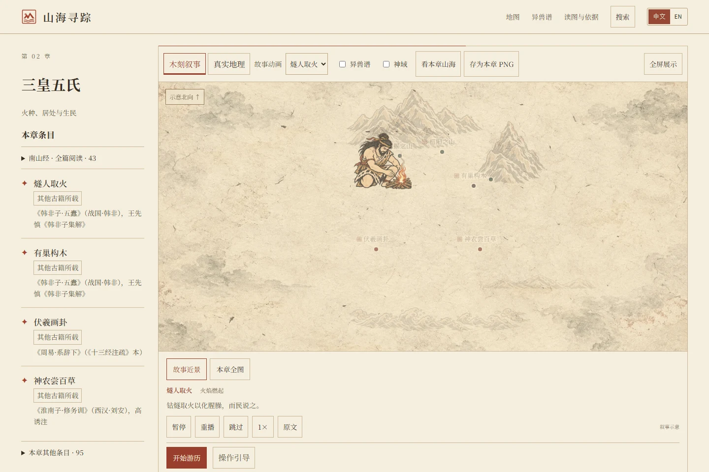
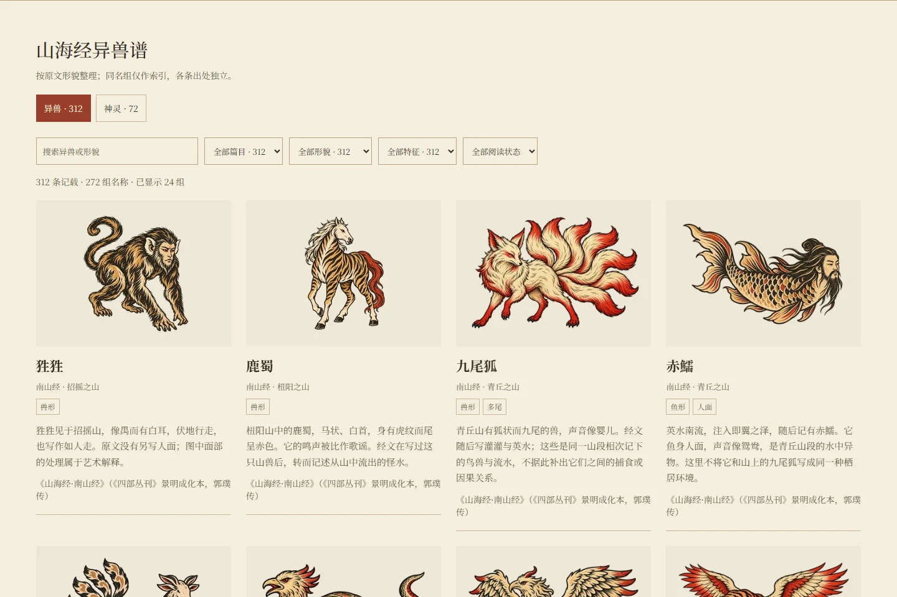
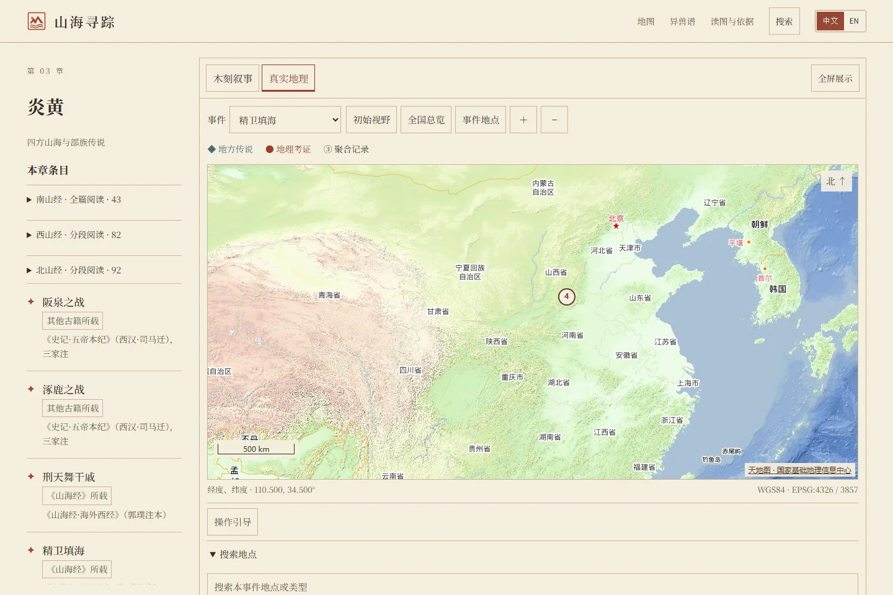
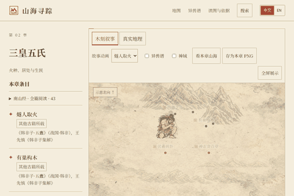

# 山海寻踪 MythMap

一部可以游历、检索与对照原文的双语中国神话图谱。

[](https://hyc1005.github.io/mythmap/)
[](https://github.com/hyc1005/mythmap/actions/workflows/deploy-pages.yml)

[English](README.md) · **简体中文**

## 30 秒了解

- **这是什么**：以木刻插画与互动地图串联《山海经》及其他古籍中的神话。
- **能做什么**：看故事、读原文、筛选异兽神祇，并查看独立的地理证据。
- **不能证明什么**：插画、叙事图坐标和现代地点关联，均不能证明神话事件发生的位置。


## 看看能做什么

| 故事播放 | 异兽谱 |
| --- | --- |
|  |  |
| 随故事展开画面，也可暂停、重播与查阅原文。 | 按名称、篇目和形貌筛选，同名异篇保留独立记载。 |
| **地理证据** | **12 秒操作演示** |
|  |  |
| 将现代地点资料与神话叙事分开查看。 | 实际界面录制，展示故事播放与异兽检索。 |

## 当前内容

- **480个阅读段**：南山43、西山82、北山92、东山51、中山212。其余十三篇暂不进入本轮补全排期，范围与待核状态见[内容盘点](docs/content-coverage.md)。
- **312条异兽、72条神灵**：支持同名分组、六类形貌及篇目／特征／已读收藏组合筛选，首批显示12张主卡片，每次追加最多24张；同名记载在详情中选择。
- **中文与英文**：故事播放、原文阅读、搜索、收藏和续读；序章与七章为项目叙事编排。

## 来源与许可

代码由维护者驱动模型开发，按[MIT](LICENSE)开放。项目白话与模型译文、AI插画暂不额外开放复用；古籍录文、扫描、字体与地图按各自来源条件处理，详见[资产来源与许可](ASSETS.md)。

翻译由模型生成；插画使用OpenAI图像生成工具，部分以项目既有插画统一风格。具体模型和第三方权利未能核实的项目保留“未记录／需确认”，不作专业审校或无侵权保证。

引用项目可使用[CITATION.cff](CITATION.cff)；引用具体原文、扫描或地图数据时，请同时标明对应来源。地理截图保留天地图署名，其使用条件仍列入许可待核事项。

## 开发与维护

<details>
<summary>目录与数据维护</summary>

| 路径 | 职责 |
| --- | --- |
| [frontend/](frontend/) | React/Vite网站，Pages部署其构建产物 |
| [frontend/src/](frontend/src/) | 界面、状态、双语与异兽展示元数据 |
| [frontend/public/data/](frontend/public/data/) | 运行数据与发布插画版本 |
| [frontend/artwork-source/](frontend/artwork-source/) | 原图、提示词与复现记录 |
| [data/](data/README.md) | 分卷构建器、原文快照与审核记录 |
| [frontend/scripts/](frontend/scripts/README.md) | 验收、预览、素材与字体工具 |
| [docs/](docs/README.md) | 数据约定、来源清单与项目文档 |

短名、形貌与同名组维护在`frontend/src/bestiary-metadata.json`，独立于生成的经文数据。数据约定见[API说明](docs/API_CONTRACT.md)。原图与扫描保留原位；[大文件清单](docs/large-files.tsv)只用于评估，不代表删除或外移安排。

### 可选原型

`backend/`、`backend-java/`与`database/`保留为可选原型，静态网站无需后端或数据库。Java服务仍被开发代理引用，FastAPI测试仍在CI中；本轮不迁移至legacy或独立分支。原型用法见[后端说明](backend/README.md)、[Java启动入口](backend-java/run.ps1)及[数据库说明](database/README.md)。

</details>

<details>
<summary>本地开发</summary>

需要Node.js 22或更新的兼容版本。

```bash
cd frontend
npm ci
npm run dev -- --host 127.0.0.1
```

打开[127.0.0.1:5173](http://127.0.0.1:5173/)。开发模式尝试8081端口的Java API，未启动时使用内置数据。可选API需JDK 17以上，运行`backend-java/run.ps1`；生产默认使用内置数据，只有显式配置`VITE_API_BASE_URL`才请求外部API，该配置会公开在构建产物中。

真实地理底图使用天地图**浏览器端应用**Key，在被忽略的`frontend/.env.local`配置`VITE_TIANDITU_KEY`。服务商域名白名单填写`hyc1005.github.io,127.0.0.1`。底图不可用时仍可阅读和查询本地资料。

</details>

<details>
<summary>构建与完整验证</summary>

在`frontend/`目录执行：

```bash
npx playwright install chromium webkit
npm run build -- --base /mythmap/
npm run verify:data
npm run verify:cache
npm run verify:publish
node scripts/with-preview.mjs --base /mythmap/ -- node scripts/verify-bestiary.mjs
node scripts/with-preview.mjs --base /mythmap/ -- node scripts/verify-design.mjs
```

阅读、搜索、叙事和各山经的验收入口见[脚本索引](frontend/scripts/README.md)。统一预览工具使用空闲端口，完成或失败后关闭自己创建的进程；人工预览运行`npm run preview:managed -- --base /mythmap/`，结束按Ctrl+C。验证期间不要重新构建同一份`dist/`。截图保存在`output/qa/`；日常验证使用Chromium、WebKit，Firefox不在已支持验收范围内。

</details>

<details>
<summary>部署与回退</summary>

仓库Settings → Pages选择**GitHub Actions**，并配置Actions secret **TIANDITU_BROWSER_KEY**。推送到`main`的前端、数据、后端／数据库或工作流修改会运行[deploy-pages.yml](.github/workflows/deploy-pages.yml)；纯文档修改不触发发布，也可手动运行。

所有必要检查通过后，部署同一份已验收产物。不要提交`dist/`、依赖、本地环境配置或QA输出；回退使用`git revert`后推送。

</details>

<details>
<summary>历史课程资料</summary>

[课程报告](docs/coursework/课程报告.md) · [答辩流程](docs/coursework/答辩演示流程.md)

保留历史记录，不作为当前开发、部署或主导航入口。

</details>
