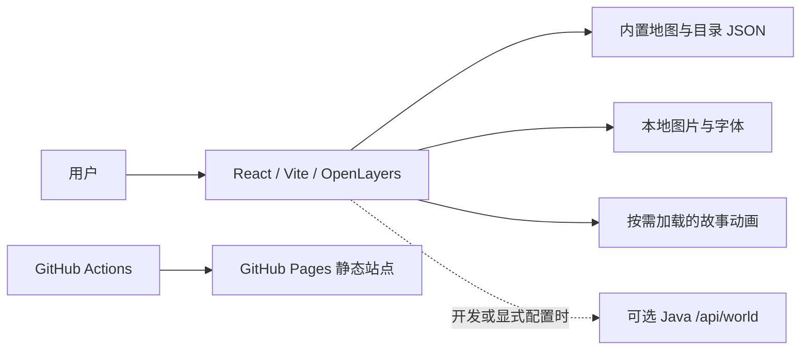
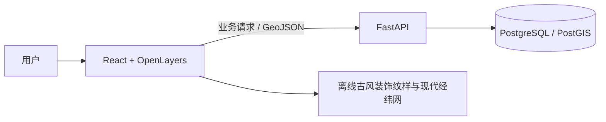

# 《山海寻踪：中国古代神话传说地图》课程报告

> 更新至 2026-10-11。本文先说明当前在线版，再保留早期 FastAPI/PostGIS 课程原型的历史记录。两版的数据统计、坐标体系和功能范围不同；运行当前在线版请参照根目录 README。

## 当前在线版：地图叙事与双语阅读

当前版本以纸本版画与古籍阅读为视觉主题，通过地图、动画、异兽谱和出处详情呈现中国古代神话。地图使用 OpenLayers 自定义 `mythic-plane`，范围为 `[0, 0, 1200, 800]`；图面位置仅表示布局、方位和叙事关系，不代表经纬度、真实距离或神话事件的历史发生地。序章至七章是项目的阅读编排，不是可考证的历史年代序列。

### 数据与文献边界

以下数量直接按当前文件的数组长度统计，不能与下文的早期数据库统计混用：

| 当前数据文件 | 统计口径 | 数量 |
| --- | --- | --- |
| `myth-world.json` | 盘古序章及七章 | 8 阶段 |
| `myth-world.json` | 地点 / 神域 / 异兽 / 自然条目 | 14 / 3 / 33 / 8 |
| `atlas/catalog.json` | 目录条目 / 人物 / 来源记录 | 43 / 32 / 39 |
| `atlas/story-animations.json` | 通用故事动画配置 | 7 |

目录条目包含故事与空间记录，43 条不表示 43 段动画。夸父追日使用单独的 `kuafu-journey.json`，盘古序章使用 Remotion；它们不计入七项通用动画配置。现代地望候选与叙事布局分开保存，缺少可靠依据时保持几何为空，不以示意位置代替地理考证。

“尧禅舜”所引“天之历数在尔躬”一段已改归《论语·尧曰》20.1，并提供台北孔庙原文复核入口。该修正只确认这段引文出处，不意味着尧都、舜都的现代地望或全部来源条目均已核实。插画属于本项目的艺术解释；导航山海印章与“读图与依据”旁的藏书印属于品牌装饰，不作为古本插图或新增文献证据。

### 系统与交互

前端采用 React JavaScript/JSX、Vite 与 OpenLayers。盘古、夸父和通用故事动画按需加载；页面支持动画播放、暂停、速度切换、重播，地图原生全屏与模拟全屏，以及地点、神域和异兽的出处详情。异兽谱保留同名异篇记录，避免把不同篇目的描述合并为同一条证据。

默认生产版使用内置数据，无需 FastAPI、PostGIS 或 Java。开发模式尝试请求 Java `/api/world`，请求失败或返回数据不兼容时沿用内置数据；生产版只有显式配置 `VITE_API_BASE_URL` 才请求外部 API。旧版筛选与空间聚类接口没有接入当前页面。

### 国际版本与视觉资源

导航栏提供中文 / EN 切换。`?lang=zh` 或 `?lang=en` 优先于本地保存的语言选择。英文版保留中文原文折叠区，并支持用中文名称检索异兽；英文内容是项目译文，不冒充某个已出版的英文译本。英文标题使用 Lora，正文使用 Source Sans 3，字体文件与许可随站点发布，无需用户安装字体软件。

76 张大图已转换为无损 WebP，转换时逐张解码核对 RGBA 像素一致，合计由 161,982,272 字节降至 118,255,582 字节，节省约 43.7 MB。原 PNG 保存在 `frontend/artwork-source/optimized-originals/`；发布素材与清单引用同步更新。导航 SVG 静止时为山海印章，悬浮时日轮缓升、海纹流动；触屏或系统要求减少动态效果时保持静态。

### 验证与复现

2026-10-11 已完成本地构建、中英文内容与布局验证，以及五种视口的完整叙事回归。验证覆盖故事播放与暂停、时间轴交接、详情、原生与模拟全屏、搜索、语言记忆、字体加载和导航 SVG 的实际动画变化。测试脚本与截图位置见根目录 README；这不代表所有文献条目的学术考证已完成。

当前版使用 Node.js 22 或兼容版本，在 `frontend/` 执行 `npm ci`，再按根目录 README 的 `/mythmap/` 路径构建和预览。另一个终端设置 `ATLAS_URL` 后运行 `npm run verify:layout`、`npm run verify:locale`；需要完整叙事检查时再运行 `npm run verify:narrative`。推送到 `main` 的前端修改会触发 GitHub Actions，布局验证通过后发布 GitHub Pages；仅修改 docs 不会触发页面部署。

演示结束后用 `Ctrl+C` 关闭开发和预览服务，释放 5173 / 4173；若运行了可选 Java 服务，也应释放 8081。当前仍需逐条核对尚未确认的注疏归属和现代地望，并保持原文、后世解释、布局示意与品牌装饰之间的区别。

## 早期课程原型：历史记录

以下保留早期报告中的数据规模与数据库实测记录，仅适用于独立原型。其架构和坐标说明不适用于上文的当前在线地图；旧版复现入口为 [backend/README.md](../backend/README.md)、[database/README.md](../database/README.md) 和 [data/README.md](../data/README.md)。

### 摘要

本项目面向传统文化公众与学生，围绕《山海经》构建可在个人电脑运行的交互式 WebGIS。系统以精选故事、人物、地点及关联数据为基础，提供地图筛选、故事与地点互查、定位依据展示和空间聚集分析。项目将古籍叙事地点与现代地理对应作为有来源、有不确定性的解释记录，不把地图上的示意位置当作神话事件的历史发生地。

### 研究范围与资料方法

首版以《山海经》为核心语料，整理 24 个故事、38 个地点，覆盖山川地理、神祇、异兽、方国、神话事件五个主题。另选三条后世文献见证，收录盘古开辟、女娲造人与补天，使公众能够沿相对叙事顺序阅读创世传说与《山海经》故事；它们在数据中保留各自来源，不并入《山海经》原文。时间线表达的是阅读次序，不为神话人物或事件虚构历史年代。每条故事记录篇章、原文摘录和文本来源；地点对应作为独立候选记录，记录现代对应名、几何、可信度、说明及定位来源。

文本收录、现代地名解释和几何来源分别登记，避免把古籍原文、后世注释和现代地理判断混为同一种证据。当前精选数据为 24 个故事、38 个地点、16 个人物和 28 条来源记录。每个故事均保留篇章和短原文摘录；文本依据、现代对应解释和坐标来源分开关联。两处可映射候选为现代华山和泰山山峰点，坐标分别引用 OpenStreetMap 山峰节点；其几何表示现代峰顶，不表示古代山体边界或神话事件发生点。相关现代对应解释另引地方公开资料。昆仑、九疑相关候选保留不同说法但不赋予坐标。

地点可信度统计为较明确 2 个、存在多种说法 2 个、无法准确定位 34 个。样本数量达到计划范围；定位明确的地点比例较低，反映本项目优先记录考证依据、不以自动地理编码补点的收录规则。

首批南山经三处已以《四部丛刊》影印明成化本第16–21页校核，保存经文、郭注摘录与编辑整理；其他既有条目尚未统一逐页对校。内容范围与缺口见[内容盘点](content-coverage.md)。其他既有文本入口为[中国哲学书电子化计划《山海经》](https://ctext.org/shan-hai-jing)，各条记录另指向对应篇章。华山与泰山的现代对应解释及峰顶坐标来源分开登记；坐标分别引自 [OpenStreetMap 华山节点](https://www.openstreetmap.org/node/2260053296) 和 [OpenStreetMap 泰山节点](https://www.openstreetmap.org/node/2338427466)。OpenStreetMap 坐标数据按 ODbL 使用，地图和报告需保留[来源署名与许可说明](https://www.openstreetmap.org/copyright)。现代对应解释来源列于 [数据来源说明](../data/README.md) 与地点详情。

### 系统设计

系统采用 React、TypeScript、Vite 和 OpenLayers 实现交互前端，FastAPI 提供故事、地点、统计及 GeoJSON 接口，PostgreSQL/PostGIS 保存实体、关联和空间几何。地图缩放时的屏幕点位合并由 OpenLayers 完成；空间分析由 PostGIS 执行，两者目的和尺度不同。

故事、人物、地点及来源通过关系表连接。每个地点可以没有定位候选，也可以有多个候选。地图接口只返回有几何的候选，内容接口保留全部条目。系统按相同筛选口径返回列表、地图和分析数据，避免结果之间相互矛盾。

### 空间分析方法

分析仅使用唯一、较明确的主点位候选，并排除未定位、区域范围、示意点及多候选地点；同一地点在分析中只计一次。几何从 EPSG:4326 转换至以米计量、中心位于东经 105°、北纬 35° 的方位等距投影后运行 DBSCAN，邻域距离 250 千米，最少 3 个点。当前本机数据库实测有 2 个符合纳入条件的点，少于最少点数；接口返回聚类数 0、噪声点 2。

分析描述的是典籍记载和本项目整理结果的空间分布，不代表神话事件曾在这些现代位置发生。由于样本是精选语料，聚集结果只作探索性展示，不外推为全部中国神话的空间格局。

### 实际数据与结果

五类主题的故事数分别为：山川地理 3、神祇 2、异兽 1、方国 8、神话事件 10。空间分析固定参数为 250 千米邻域和最少 3 点；实测纳入 2 个明确点位、成簇 0 个、噪声 2 个。地图背景为本地古风山水装饰纹样，不含地理坐标；故事时间线独立于坐标显示。

### 局限与后续工作

古地名与现代地名之间存在时代变迁、文献异说和研究解释差异；当前 38 个地点中大多数没有可支持的精确现代对应，DBSCAN 样本偏少且没有形成聚类。地图使用本地古风山水纹样，不绘制现代行政边界；纹样不带地理坐标，仅用于营造阅读氛围。经纬网及有依据的候选标记仍采用现代 WGS84 坐标，不能据此推断古代疆域或神话事件的发生地。现场演示无需联网加载地图瓦片。后续可扩充注释来源、提供候选说法对照，并在来源和研究范围明确后扩展到其他古代文献。

### 复现方式

早期原型在本机分别运行 PostgreSQL/PostGIS、FastAPI 与当时的前端。数据库初始化、数据导入、环境变量和 API 启动步骤参见 [backend/README.md](../backend/README.md) 与 [database/README.md](../database/README.md)；当前根目录 README 描述的是静态在线版，不提供旧版前端界面的复现承诺。原型的 API 与数据检查可按各目录说明单独运行。
